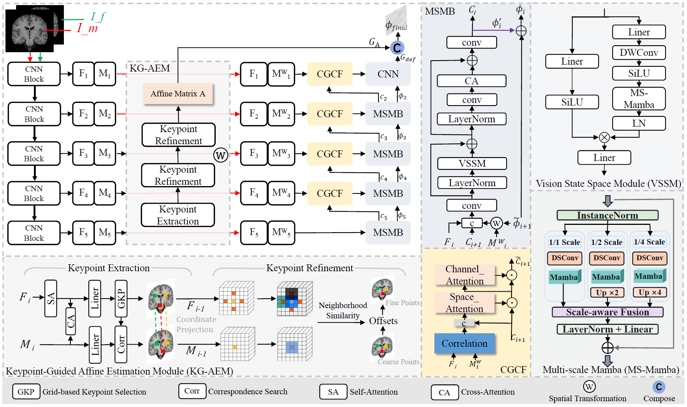

# KAD-Morph

**Keypoint-Guided Affine-Decoupled Coarse-to-Fine Network for 3D Brain MRI Registration**

Medical image registration is a fundamental step in medical image analysis. Most existing deep learning-based registration methods are designed under the assumption that images have been pre-aligned, making them difficult to handle cases where global spatial misalignment and local anatomical deformation coexist. However, in practical applications, the images to be registered may not have good initial alignment, and differences in translation, rotation, and scale between images can significantly increase the difficulty of deformation estimation. To address the difficulty of jointly handling global spatial misalignment and local anatomical deformation in registration, we propose KAD-Morph, a keypoint-guided affine-decoupled coarse-to-fine registration network. The proposed method decomposes the overall spatial transformation into global affine alignment and local residual deformation, and models them separately. Specifically, it estimates the global affine transformation through explicit keypoint correspondences. Meanwhile, multi-scale spatial modeling and correlation-guided information filtering are incorporated to improve the reliability of complex local deformation modeling. Experiments are conducted on three public brain MRI datasets. The results show that KAD-Morph outperforms existing methods with and without additional rigid pre-alignment, demonstrating its effectiveness in scenarios with complex initial misalignment. 
## Architecture

  

## Repository Structure

<pre>
├── TrainDataset/
├── TrainDataset_rigid/
├── Buckner/
├── Buckner_rigid/
├── LPBA/
├── LPBA_rigid/
├── Mindboggle/
├── Mindboggle_rigid/
└── KAD-Morph/
    ├── csv/
    ├── datagenerators.py
    ├── losses.py
    ├── networks.py
    ├── test_noHD95_1K.py
    ├── train.py
    └── models/
</pre>

